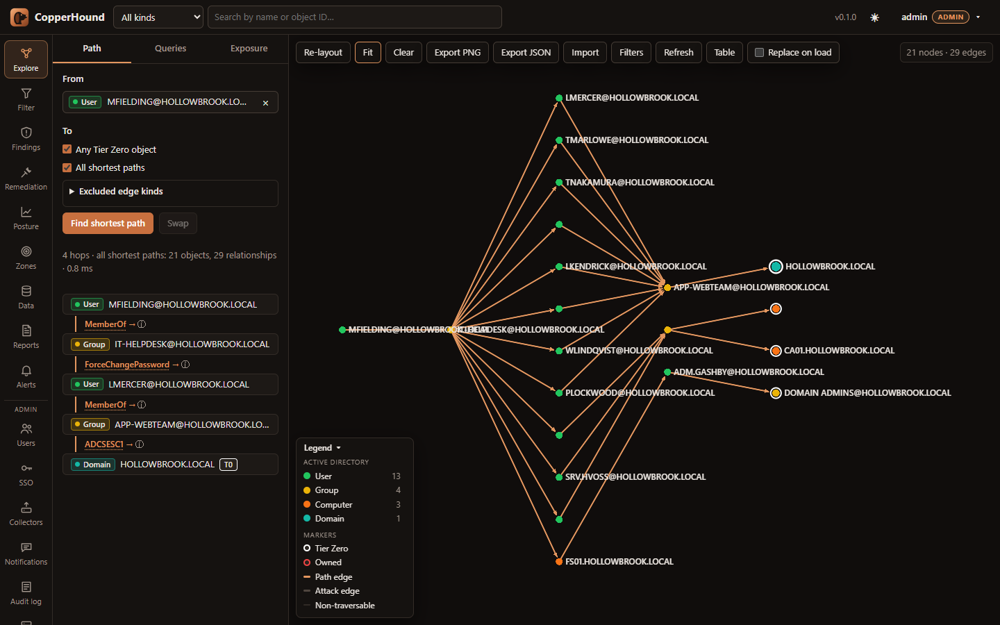
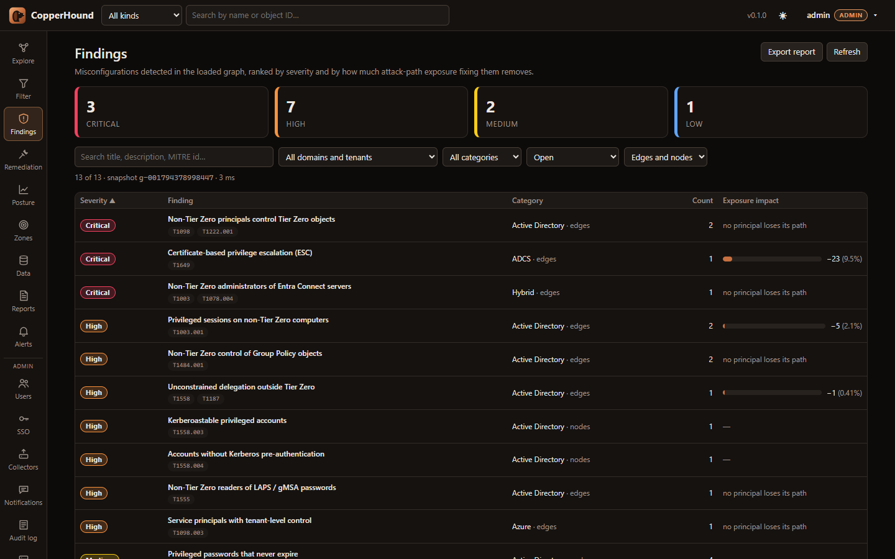
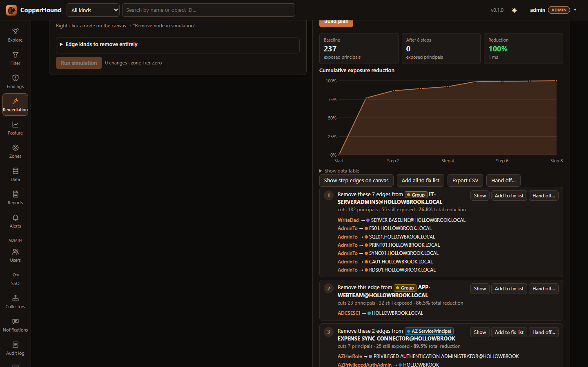
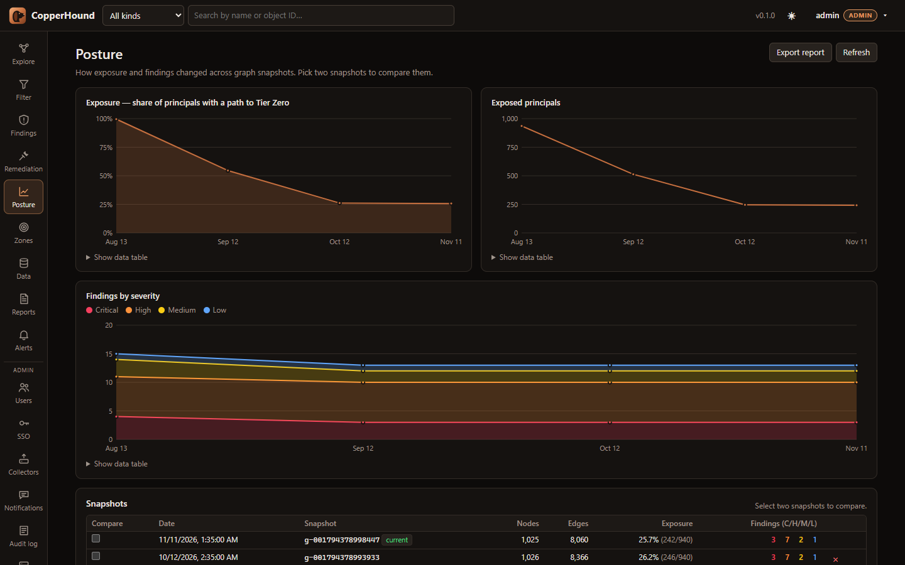

<p align="center"></p>

# CopperHound

Open-source Active Directory, ADCS and Entra ID / Azure attack-path analysis,
built in Rust for very large environments. CopperHound ingests SharpHound,
bloodhound-python, ldapdomaindump and AzureHound output, raw LDIF dumps and
Sysinternals AD Explorer snapshots into a memory-mapped graph store and runs
path, exposure and CHQL queries directly on it, with no graph database. One
container serves the web UI and REST API.



<table>
<tr>
<td></td>
<td></td>
<td></td>
</tr>
</table>

<sub>Screenshots use fabricated demo data (<code>scripts/demo_data.py</code>).</sub>

**Documentation:** [User guide](docs/USER_GUIDE.md) · [Deployment](docs/DEPLOYMENT.md) ·
[Data sources](docs/DATA.md) · [REST API](docs/API.md) · [CHQL](docs/CHQL.md) ·
[Edge reference](docs/EDGES.md) · [OT](docs/OT.md) · [Performance](docs/PERFORMANCE.md) ·
[Architecture](docs/ARCHITECTURE.md) · [Changelog](CHANGELOG.md)

## Quick start (Docker)

```sh
docker compose up -d --build
docker compose logs copperhound | grep "Initial admin password"
```

Open <http://127.0.0.1:8090>, sign in as `admin`, drop your SharpHound /
AzureHound `.zip` or `.json` files on the **Data** tab and press **Rebuild
graph**. `COPPERHOUND_ADMIN_PASSWORD` sets the password, and
`COPPERHOUND_PORT` / `COPPERHOUND_HOST` change the published address (default
`127.0.0.1:8090`, so it can run next to BloodHound on 8080).

**No data yet?** `python scripts/demo_data.py demo/` writes a fabricated
environment (AD, ADCS and Entra ID with deliberate weaknesses) to upload; see
[Try it with demo data](docs/USER_GUIDE.md#try-it-with-demo-data).

Without Docker: `cd web && npm ci && npm run build`, then
`cargo run --release -- serve` (defaults: `127.0.0.1:8080`, data in `./data`,
UI from `./web/dist`).

Accounts, API tokens, the watch folder, scheduled reports, change alerts, HTTPS
and single sign-on (OpenID Connect, SAML 2.0): [docs/DEPLOYMENT.md](docs/DEPLOYMENT.md).

## Risk analysis

Computed in the background after every ingest:

- **Attack-path findings** — 42 finding types across AD, ADCS, Entra ID,
  hybrid and OT (DCSync outside Tier Zero, control of Tier Zero, rights of broad groups,
  delegation to Tier Zero, ESC escalations, tenant-takeover Graph permissions,
  synced accounts holding Entra Tier Zero roles, …), each with severity,
  impact, remediation guidance and MITRE ATT&CK techniques. Every edge finding
  is **measured**: "fixing this removes N principals' paths to Tier Zero",
  computed by re-running the exposure analysis without its edges.
- **What-if simulation** — remove any set of edges, edge kinds or nodes (or add
  targets) and see before/after exposure per kind, instantly.
- **Remediation planner** — a dominator tree over every attack path finds the
  choke object whose fix cuts the most principals off from the zone
  *entirely*. The plan is recomputed after each step, so the cumulative
  reduction curve is exact. Members of zone groups are treated
  as part of the zone, so it never proposes "remove the admins from Domain
  Admins".
- **Remediation hand-off** — turn fix-list edges or plan steps into a
  PowerShell script (one suggested command per edge, objects named by SID /
  object id) or into Jira issues, ServiceNow records or signed webhook events
  with the guidance and command for each edge.
- **Privilege zones** — define your own target sets with a CHQL selector
  ("Tier 1 servers", "Finance file servers", …) and get exposure, choke points
  and remediation plans for each. In a zone's member review you certify the
  members that belong and revoke ones the rule picked up by mistake (they drop
  out of the zone); new matches show as pending.
- **OT** — mark Purdue levels and add PLCs with `CanProgram` edges from an
  asset inventory (OpenGraph). OT findings, zone templates and queries then find
  paths from IT into the plant. Two more inputs are optional: fix costs for
  maintenance windows, and network conduits so paths respect the firewall.
  See [docs/OT.md](docs/OT.md).
- **Posture over time** — one snapshot per ingest (exposure %, findings by
  severity, per-finding counts) and a diff between any two snapshots listing
  exactly which finding items appeared or were resolved.

CLI equivalents: `copperhound findings corp.chg`, `copperhound plan corp.chg --steps 10`.

## Web UI

A WebGL graph canvas (sigma.js) with search, pathfinding, node details, "How was
this derived?" for every derived edge, the CHQL editor and query library, and
pages for findings, remediation, zones, posture, reports, data and
administration. Walkthrough with screenshots: [docs/USER_GUIDE.md](docs/USER_GUIDE.md).

## CHQL

A read-only Cypher dialect compiled to native graph operations — multiple
patterns and `MATCH` clauses, `OPTIONAL MATCH`, `WITH`, aggregation,
`ORDER BY`/`SKIP`/`LIMIT`, `UNION`, undirected and variable-length hops, path
functions and pattern predicates. Most BloodHound CE and legacy queries run
unchanged; see the [CHQL reference and Cypher compatibility table](docs/CHQL.md).

```
MATCH p = shortestPath((u:User {name:'JDOE@CORP.LOCAL'})-[*1..]->(t {tier0:true})) RETURN p
MATCH p = allShortestPaths((g:Group)-[*1..]->(t {tier0:true})) WHERE g.name STARTS WITH 'DOMAIN USERS@' RETURN p
MATCH (u:User {hasspn:true, enabled:true}) WHERE u.pwdlastset < 1600000000 RETURN u.name, u.pwdlastset
MATCH (g:Group)-[:AdminTo]->(c:Computer) RETURN g.name, count(c)
MATCH (p)-[r:ADCSESC1|ADCSESC6a]->(d:Domain) RETURN p, r, d
MATCH (n {owned:true}), (m:Group) WHERE m.objectid ENDS WITH '-512' MATCH p = shortestPath((n)-[*1..]->(m)) RETURN p
MATCH (dc)-[:MemberOf*0..]->(g:Group) WHERE g.objectid ENDS WITH '-516' WITH collect(dc) AS dcs
  MATCH (c:Computer {unconstraineddelegation:true}) WHERE NOT c IN dcs RETURN c
```

On the command line: `copperhound query corp.chg "MATCH …"`. `days_ago(n)`
gives relative timestamps, e.g. `WHERE u.lastlogontimestamp < days_ago(90)`.

The UI ships with **173 prebuilt queries** in 16 categories (Domain
Information, Dangerous Privileges, Kerberos, Delegation, ACL Abuse, Sessions &
Lateral Movement, GPO & OU, Hygiene, Shortest Paths, Tier Zero, Owned, ADCS,
Azure / Entra ID, Azure Resources, Hybrid and OT / ICS), each tagged and tested against a
synthetic graph. Your own queries can be saved server-side.

## Performance

Records are scanned from memory-mapped files on every core into a compressed
sparse row graph that opens in milliseconds; paths and Tier Zero exposure run as
purpose-built BFS passes on it. A 10 GB SharpHound collection (12.5M objects,
65.7M edges) ingests in 23–31 s, and a shortest path to Tier Zero on it takes
under 1 ms. Design, choke-point algorithm and benchmarks:
[docs/PERFORMANCE.md](docs/PERFORMANCE.md).

## Usage

```sh
# Ingest: any mix of .json files, .zip archives and directories
copperhound ingest 20241105_BloodHound.zip ldd_out/ -o corp.chg
# Several collections of the same domain: the newest collection wins per object
# (see docs/DATA.md; `--merge union` for a plain union)
copperhound ingest 20241001093000_BloodHound.zip 20241105101500_BloodHound.zip -o corp.chg

copperhound stats corp.chg

# Shortest attack path (names or SIDs/GUIDs, case-insensitive)
copperhound path corp.chg --from jdoe@corp.local --to "DOMAIN ADMINS@CORP.LOCAL"
copperhound path corp.chg --from jdoe@corp.local --to-tier0 --exclude HasSession

# Tier Zero exposure and the edges whose removal cuts the most attack paths
copperhound tier0 corp.chg --top 25
copperhound tier0 corp.chg --json > exposure.json

# Blast radius
copperhound reach corp.chg --from WS042.CORP.LOCAL

# Property filter (JSON filter tree, see docs/API.md) and name search
copperhound filter corp.chg '{"and":[{"kind":"User"},{"truthy":"enabled"},{"truthy":"hasspn"}]}'
copperhound search corp.chg backup --kind User
copperhound columns corp.chg        # list property columns (builds them for older graphs)
```

`--all-edges` includes non-traversable edges (e.g. `GetChanges`, `TrustedBy`);
`--exclude A,B` drops edge kinds; `--threads N` caps parallelism.

## Supported input

SharpHound (v4–v6, CE) and bloodhound-python JSON, SharpHound ADCS, AzureHound
(v2, v3), ldapdomaindump, LDIF (`ldapsearch`, `ldifde`, gzipped), Sysinternals AD
Explorer snapshots and OpenGraph JSON for custom node and edge kinds, as files,
directories or `.zip` archives. CopperHound can also collect over LDAP itself.
Several collections of the same domain merge object by object, newest wins.
Formats, raw LDAP collection, derived edges, Tier Zero defaults and merge rules:
[docs/DATA.md](docs/DATA.md).

## Layout

| crate | role |
|---|---|
| `ch-model` | node/edge kinds, flags, Tier Zero rules |
| `ch-store` | CSR build, on-disk columnar format, mmap open, lookups |
| `ch-ingest` | scanner, SharpHound / ldapdomaindump / AzureHound / LDIF / AD Explorer parsers, interner, merge, ADCS + Azure post-processing |
| `ch-engine` | paths, Tier Zero exposure, choke points, reach |
| `ch-query` | CHQL parser, planner, executor |
| `ch-server` | REST API (axum), auth, uploads, ingest jobs, static UI |
| `ch-synth` | synthetic dataset generator |
| `copperhound` | CLI (`ingest`, `serve`, `query`, `path`, `tier0`, `reach`, `stats`, `synth`) |
| `web/` | React + TypeScript + sigma.js UI |
| `scripts/` | `demo_data.py`: fabricated demo environment; `accuracy-diff.sh` |
| `tools/` | helper scripts (`ldap-member-ranges.sh` / `.ps1`: complete large-group `member` ranges for LDIF dumps) |

See [docs/ARCHITECTURE.md](docs/ARCHITECTURE.md) for design details and the roadmap.

## Changelog

Each version, in short; the details are in [CHANGELOG.md](CHANGELOG.md).

- **0.2.0** (2026-11-13): OT support and bug fixes.
  - OT: `CanProgram` edges, Purdue levels, OT findings, queries and zone
    templates; fix costs in the remediation planner; network reachability
    through firewall conduits. See [docs/OT.md](docs/OT.md).
  - Fixes from a security review: query and ingest denial of service, report
    and PowerShell injection, SSO login CSRF, secret handling. Plus query
    correctness fixes, and BloodHound-signed uploads over 8 MiB work again.
- **0.1.0** (2026-11-11): first public release.

## License

Apache-2.0. CopperHound is an independent project and is not affiliated with
SpecterOps or BloodHound; it reads the open collector output formats.

Use CopperHound only against environments you are authorised to assess.
