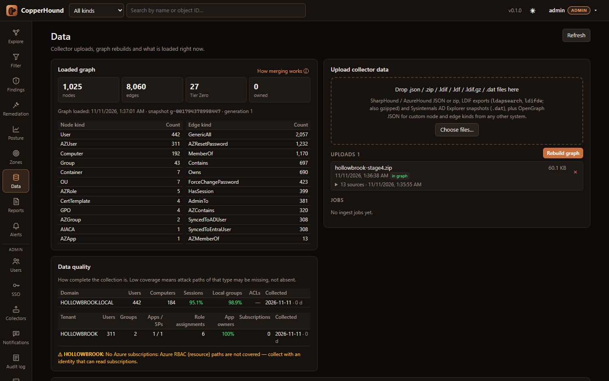
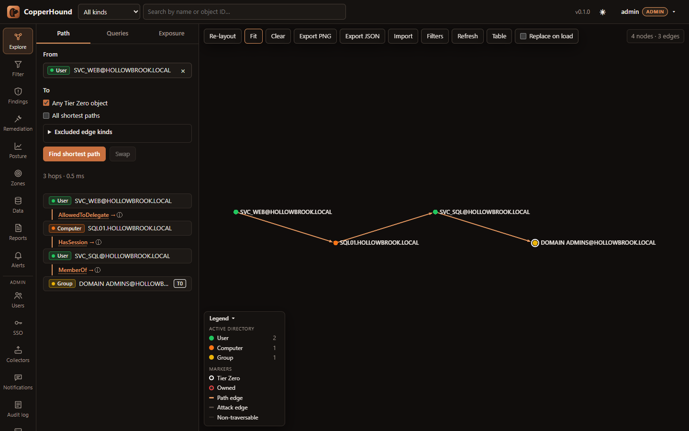
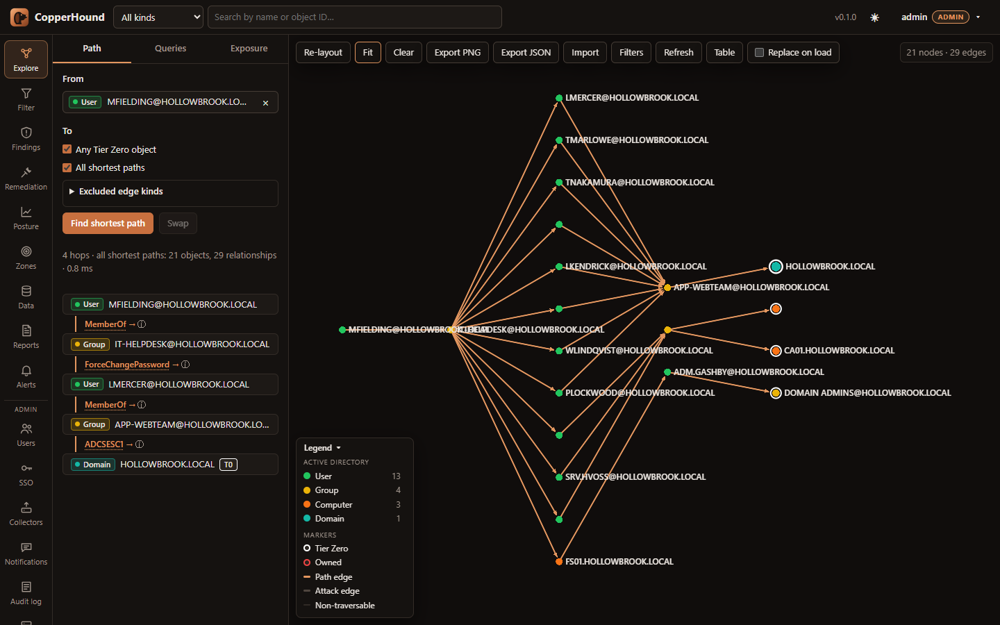
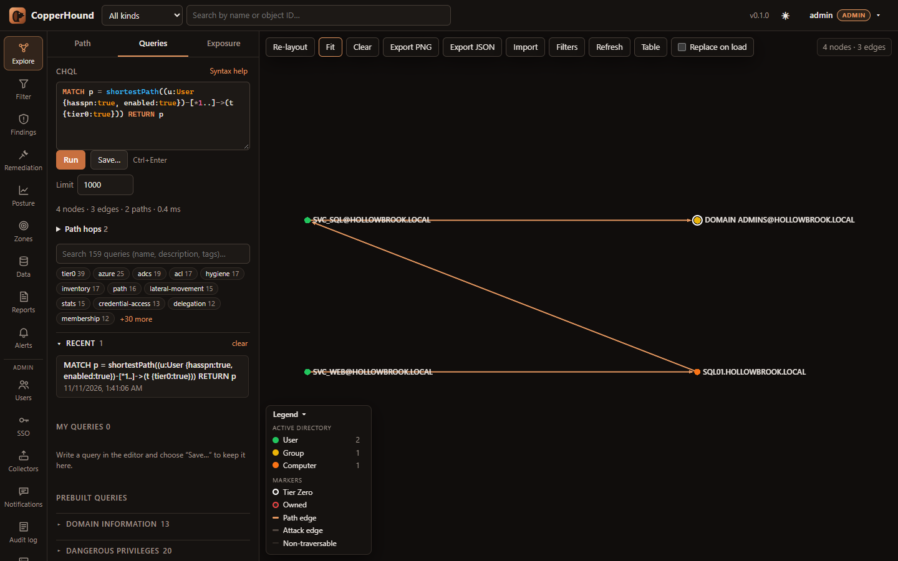
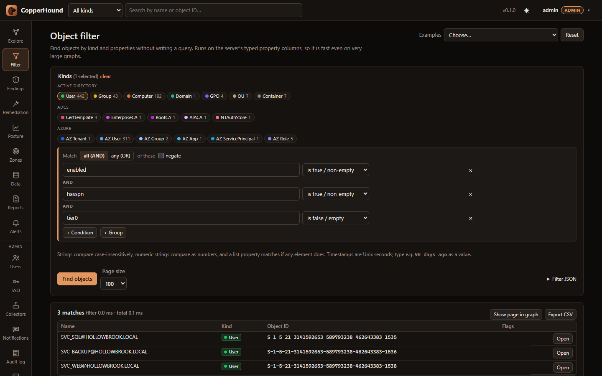
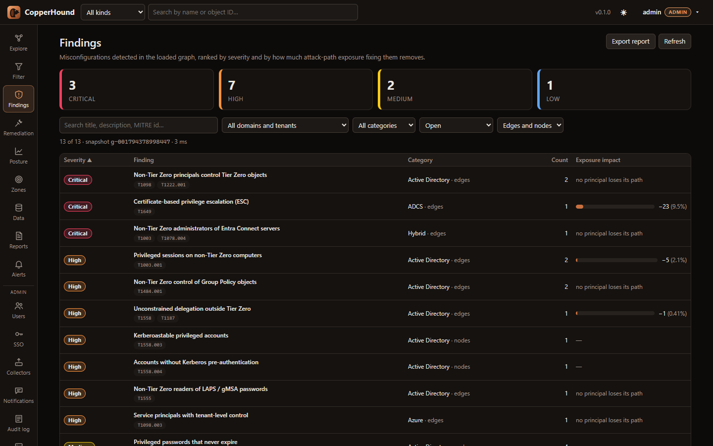
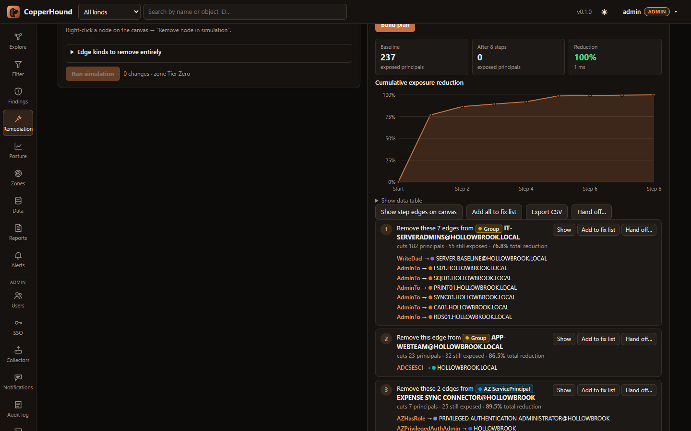
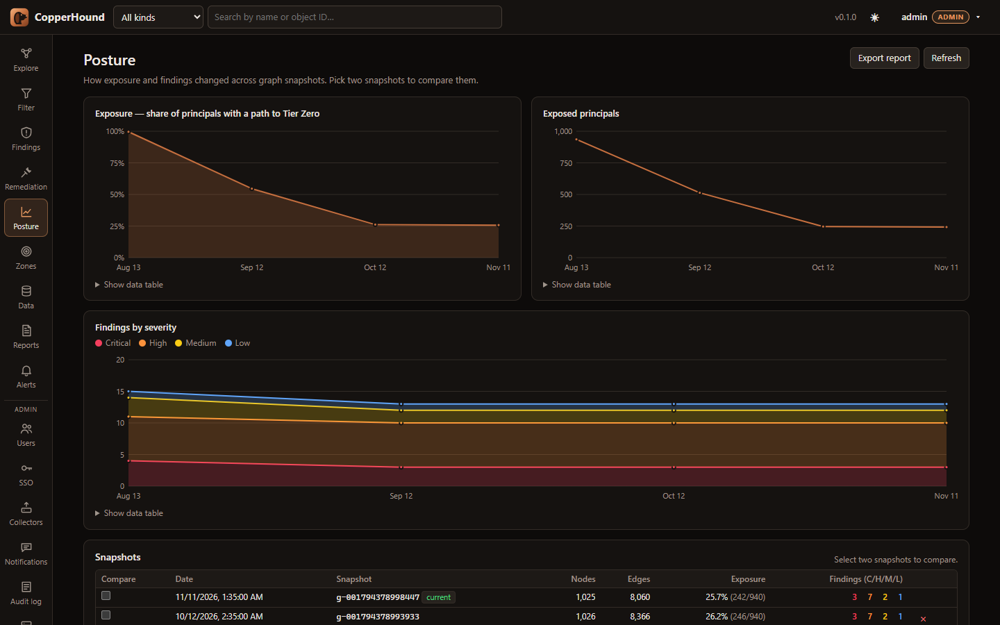

# CopperHound user guide

A tour of the web UI, from loading data to handing fixes to the people who make them.
For the REST API see [API.md](API.md); for the query language see [CHQL.md](CHQL.md).

All screenshots use **fabricated data**: "Hollowbrook" (`HOLLOWBROOK.LOCAL`, tenant
`hollowbrook.example`) is a made-up company produced by
[`scripts/demo_data.py`](../scripts/demo_data.py). To load it yourself, see
[Try it with demo data](#try-it-with-demo-data).

- [Install and sign in](#install-and-sign-in)
- [Try it with demo data](#try-it-with-demo-data)
- [Load your own data](#load-your-own-data)
- [Explore: paths and the graph](#explore-paths-and-the-graph)
- [Queries (CHQL)](#queries-chql)
- [Object filter](#object-filter)
- [Findings](#findings)
- [Remediation: simulate and plan](#remediation-simulate-and-plan)
- [Zones](#zones)
- [Posture and alerts](#posture-and-alerts)
- [Reports](#reports)
- [Administration](#administration)
- [Roles](#roles)

## Install and sign in

```sh
docker compose up -d --build
docker compose logs copperhound | grep "Initial admin password"
```

Open <http://127.0.0.1:8090> and sign in as `admin` with that password (or set
`COPPERHOUND_ADMIN_PASSWORD` before the first start). Change it under **Account**, and turn
on **two-factor sign-in** there too. For HTTPS, single sign-on and other deployment options
see [DEPLOYMENT.md](DEPLOYMENT.md).

## Try it with demo data

```sh
python scripts/demo_data.py demo/             # SharpHound + AzureHound JSON, current state
cd demo && zip ../hollowbrook.zip *.json      # or select all the files in the upload dialog
```

Upload `hollowbrook.zip` on the **Data** page and press **Rebuild graph**. The data has
about 450 users, 190 computers, an ADCS PKI and an Entra ID tenant, with deliberate
weaknesses: a helpdesk that can reset server admins' passwords, a kerberoastable Domain
Admin, an ESC1 certificate template, unconstrained delegation and more.

`--stage 1` … `--stage 4` produce monthly collections (August to November) in which those
weaknesses get fixed in batches. Ingest them in order (delete the previous upload each
time) to see posture history and change alerts at work.

## Load your own data



**Data** shows what is loaded and accepts uploads:

- SharpHound CE / legacy and bloodhound-python JSON or zips, AzureHound JSON,
  ldapdomaindump output, LDIF exports (`ldapsearch`, `ldifde`, gzipped), Sysinternals AD
  Explorer snapshots (`.dat`) and OpenGraph JSON for custom node and edge kinds.
- **Rebuild graph** re-ingests every upload and swaps the new graph in without downtime.
  Several collections of the same domain are merged object by object, newest wins
  ("How merging works").
- **Data quality** shows what the collection is missing (sessions, local groups,
  Azure subscriptions…), so a short list of paths is not mistaken for a clean
  environment.

Other ways in: the watch folder (**Admin → Server**), the built-in LDAP collector and
collector clients (**Admin → Collectors**), and the BloodHound-compatible upload API, which
lets existing SharpHound / AzureHound upload jobs point at CopperHound.

## Explore: paths and the graph



**Explore** is the graph canvas with three tabs on the left:

- **Path**: pick a start, then an end object or **Any Tier Zero object**. The path is drawn
  and listed hop by hop; the ⓘ next to each edge explains what it means, how it is abused
  and how to fix it. **All shortest paths** draws every path of the shortest length:

  

- **Queries**: the CHQL editor and the query library (below).
- **Exposure**: how many principals of each kind can reach Tier Zero (or any zone), and
  the choke-point edges that most paths cross.

On the canvas:

- Search for any object in the top bar. Click a node for its details and all collector
  properties.
- Right-click a node to expand inbound or outbound edges, set it as path start or end,
  mark it owned or Tier Zero, or remove it in a simulation.
- Derived edges (DCSync, ADCS ESC*, CoerceToTGT, hybrid sync, Entra role edges) have
  **How was this derived?**, which draws the collected edges and the facts the rule used.
- **Table** lists everything on the canvas; **Export PNG**, **Export JSON** / **Import**
  save and restore a canvas; **Filters** hides kinds.

## Queries (CHQL)



CHQL is a read-only Cypher dialect, so most BloodHound CE queries run unchanged. Queries
returning paths draw on the canvas; others return a table you can export as CSV. The
library has 159 prebuilt queries, searchable and filterable by tag. Save your own with
**Save…** (they are stored on the server). Reference: [CHQL.md](CHQL.md).

## Object filter



**Filter** finds objects by kind and properties without writing a query: nested AND / OR
groups, comparisons, "90 days ago" for timestamps. It runs on typed property columns, so it
stays fast on very large graphs. Pick one of the **Examples** to start.

## Findings



**Findings** lists detected misconfigurations: 30 types across AD, ADCS,
Entra ID and hybrid. Each row shows its severity, MITRE ATT&CK techniques and **exposure
impact**: how many principals lose their path to Tier Zero if you fix it, measured by
re-running the analysis without those edges.

Open a finding to see its items, guidance and history across snapshots. From there you can:

- **Simulate fix** to try it in the simulator;
- add items to the **fix list**;
- **Accept risk** with a reason and an optional expiry date. Accepted findings move from
  the **Open** list to **Accepted risks**.

## Remediation: simulate and plan



- **What-if simulator**: remove edges, edge kinds or objects (from findings, choke points
  or the canvas context menu) and see exposure before and after.
- **Remediation planner**: each step removes the object whose onward attack edges cut the
  most principals off the zone entirely. The plan is recomputed after every step, so the
  cumulative curve is exact. It never proposes removing admins from admin groups.
- **Hand off…** turns the fix list, a whole plan or one step into:
  - a PowerShell script with one suggested command per edge;
  - Jira issues, ServiceNow records or signed webhook events.

  Review the commands before running them.

## Zones

**Zones** are target sets beyond Tier Zero, such as "Finance file servers" or "Tier 1
servers", defined by a CHQL selector. Each zone gets its own exposure, choke points and
plan. On the **Review** tab, certify the members that belong and revoke the ones the rule
picked up by mistake; revoked members leave the zone.

## Posture and alerts



Every ingest records a **posture snapshot**: exposure, findings by severity and per-finding
counts. **Posture** charts them. Tick two snapshots to see exactly which finding items
appeared or were resolved.

Admins can set up **change alerts** (Admin → Notifications) to post to Slack, Teams, email
or a webhook after an ingest. Alerts can fire when:

- the grade gets worse or exposure rises;
- new critical findings appear;
- many principals newly reach Tier Zero;
- a watched user or group gains a path, in which case the alert includes the path.

**Alerts** keeps the history. **Scheduled reports** send a summary on a timetable.

## Reports

**Reports** produces an assessment report as HTML (open or download), Markdown or CSV:

- executive summary;
- findings with guidance;
- exposure and choke points;
- optionally, the first steps of the remediation plan.

It is also available from the CLI (`copperhound report`) and the API.

## Administration

| Page | What it does |
|---|---|
| **Users** | Local accounts with roles; reset passwords and 2FA; revoke tokens |
| **SSO** | OpenID Connect and SAML 2.0 sign-in, group-to-role mapping, break-glass rules |
| **Collectors** | Built-in LDAP collection targets and upload-only collector clients |
| **Notifications** | Channels (webhook, Slack, Teams, SMTP), scheduled reports, alert rules, ticketing targets |
| **Audit log** | Every change, who made it and when |
| **Server** | Watch folder, analysis and merge settings, node kind styles, backup and restore |

Database management (clearing data) is on the **Data** page for admins.

## Roles

| Role | Can |
|---|---|
| `viewer` | Read everything: explore, query, findings, posture, reports |
| `analyst` | Viewer, plus upload and ingest, marks, saved queries, zones, risk acceptance, tickets and alert history |
| `admin` | Everything, including users, SSO, collectors, notifications and server settings |
| `uploader` | Upload and start an ingest only (for collector service accounts) |

Personal API tokens (`cht_…`, under **Account**) act with their owner's role.
